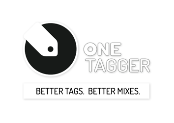

<p align='center'>
    
</p>
<h1 align='center'>The ultimate cross-platform tagger for DJs</h1>

<h3 align='center'><b>
<a href='https://onetagger.github.io/'>Upstream tutorials</a> | <a href='https://github.com/fantuz/onetagger/releases/'>Latest Release</a>
</b></h3>
<br>

<p align='center'>
    
    
    
</p>

<h3 align='center'><b></b></h3>
<hr>

This is the maintained [fantuz/onetagger](https://github.com/fantuz/onetagger) fork of
[Marekkon5/onetagger](https://github.com/Marekkon5/onetagger), with the original authors and license preserved.

Cross-platform music tagger.
It can fetch metadata from Beatport, Traxsource, Juno Download, Discogs, Musicbrainz and Spotify.
The inherited Spotify Audio Features page is currently unavailable: the backend returns an unsupported-feature error. Spotify metadata tagging is a separate feature.
There is a manual tag editor and quick tag editor which lets you use keyboard shortcuts. Written in Rust, Vue.js and Quasar.

MP3, AIFF, WAV, FLAC, M4A (AAC, ALAC), and supported Ogg-family formats are handled by the tagging backend.

*For more info and tutorials check out the [upstream website](https://onetagger.github.io/).*

https://user-images.githubusercontent.com/15169286/193469224-cbf3af71-f6d7-4ecd-bdbf-5a1dca2d99c8.mp4


## Installing

Download this fork from [releases](https://github.com/fantuz/onetagger/releases).
Before the first fork release, use artifacts from a successful [Build workflow](https://github.com/fantuz/onetagger/actions/workflows/build.yml).
Artifacts include Linux x64, Windows x64 (portable and installer), macOS Intel, and macOS ARM64, plus CLI binaries and SHA-256 checksums.
The macOS archives are unsigned; Intel and ARM64 are separate downloads. Linux artifacts are built on Ubuntu 24.04 and need compatible glibc and WebKitGTK 4.1 runtimes.

See [development and validation](docs/DEVELOPMENT.md) for the GitHub Actions pipeline and [safe file operations and browser sessions](docs/SAFETY.md) for the changed behavior.


## Credits
Marekkon5 - Original OneTagger application<br>
Bas Curtiz - UI, Idea, Help  
SongRec (Shazam support) - https://github.com/marin-m/SongRec

## Support
You can support the original upstream developers by donating on [PayPal](https://paypal.me/marekkon5) or [Patreon](https://www.patreon.com/onetagger)

## Building

### Linux
Use the Rust version in `rust-toolchain.toml`, Node.js 24, and pnpm 10.11.0.

Install dependencies: [rustup](https://rustup.rs), [node](https://nodejs.org/en/download/package-manager/), [pnpm](https://pnpm.io/installation)

**Install remaining dependencies**
```
sudo apt install -y lld autogen libasound2-dev pkg-config make libssl-dev gcc g++ curl wget git libwebkit2gtk-4.1-dev
```

**Compile UI**
```
cd client
pnpm install --frozen-lockfile
pnpm run build
cd ..
```

**Compile**
```
cargo build --workspace --release --locked
```
Output will be in: `target/release/onetagger`


### Windows
You need to install dependencies: [rustup](https://rustup.rs), [nodejs](https://nodejs.org/en/download/), [Visual Studio 2022 Build Tools](https://aka.ms/vs/17/release/vs_buildtools.exe), [pnpm](https://pnpm.io/installation)

**Compile UI:**
```
cd client
pnpm install --frozen-lockfile
pnpm run build
cd ..
```

**Compile OneTagger:**
```
cargo build --workspace --release --locked
```

Output will be inside `target\release` folder.


### macOS (Intel or Apple Silicon)

Install Rust with rustup, Node.js 24, pnpm 10.11.0, and Xcode Command Line Tools.
Build on the architecture you intend to run; liblzma is compiled from its locked crate source:

```sh
pnpm --dir client install --frozen-lockfile
pnpm --dir client run build
cargo build --workspace --release --locked
```

### Browser and server mode

The desktop window and `--browser` establish their session automatically. For a headless server:

```sh
onetagger-cli server --browser
```

Without `--browser`, open the session URL printed on the terminal. Each application restart creates a new session; stale browser tabs must use the new link. Do not publish that link. The default listener remains loopback-only. See [session security](docs/SAFETY.md#browser-sessions) before using `--expose`.
